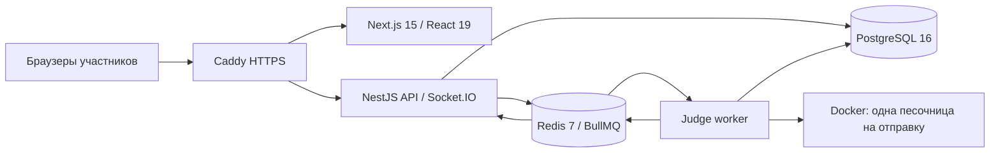

# Архитектура

`apps/api/modules/auth.ts` — роли и JWT cookie. `competition.ts` — задачи, контесты, регистрация, дуэли, команды и отправки. `integrity.ts` — события редактора, флаги, повтор, проверка хэшей и аудит решений организатора. NestJS управляет HTTP-сервером; обработчики сгруппированы по доменам, входные DTO проверяет Zod.

В БД хранятся задания и скрытые тесты, отправки, составы, дедлайны, согласия, черновики и записи. Клиент никогда не определяет вердикт или победителя. Статусы контестов и завершение дуэлей вычисляются из серверных UTC-дедлайнов и факта сдачи. Перезапуск API не сбрасывает время.

Состояние редактора сохраняется каждые 3 секунды и перед отправкой. В команде изменения дополнительно отправляются с задержкой 500 мс. Socket.IO сообщает о вердиктах, метках задач, активности и новых черновиках; сами коды чужих соперников в дуэли не передаются. При обрыве HTTP-события остаются в памяти открытой вкладки и отправляются повторно по порядку. Последнее подтверждённое состояние восстанавливается из БД.

Отправка создаётся до постановки в BullMQ. Redis использует AOF; задания имеют идентификатор Submission, повторы и защиту от повторного зачёта уже завершённой отправки. Приоритет: дуэль → контест → пример/эталон. На демонстрационном VDS воркер имеет **один** слот. Для масштабирования можно добавлять воркеры, а Socket.IO уже использует Redis adapter.

Расчёт, не нагрузочный результат: 100 дуэлей × 2 человека × 1 отправка в минуту = 3,33 отправки/с. При среднем времени проверки 1,5 с требуется 5 занятых слотов; с резервом — около 8. Реальную пропускную способность нужно измерять на задачах и железе соревнования. Один демонстрационный VDS не заявлен как готовый к 100 дуэлям.

Время в интерфейсе синхронизируется с API; участник получает `endsAt`, а не произвольное время от клиента. Проверка активности и лимит отправок выполняются API. Таблица и определение победителя используют чистые функции в `packages/shared/scoring/` с регрессионными тестами.
